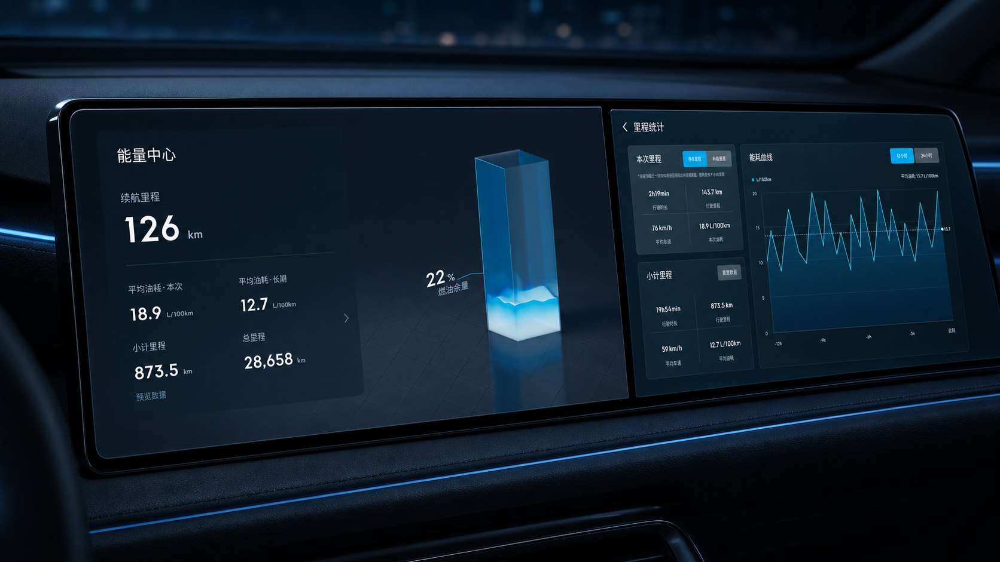
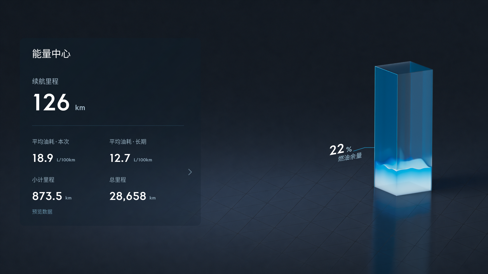
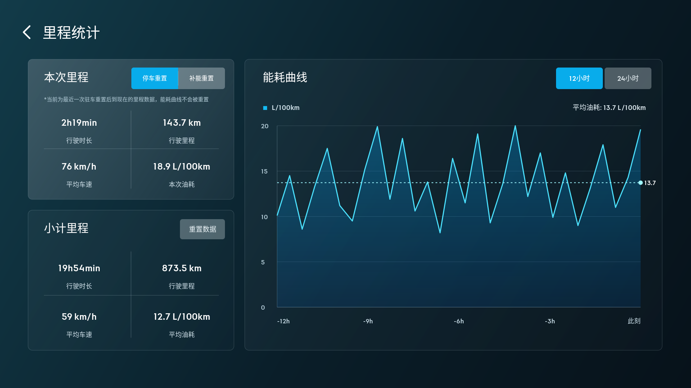
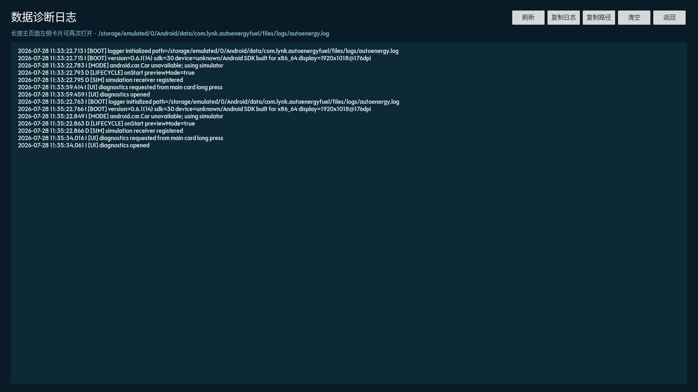

<p align="center">
  
</p>

<h1 align="center">AutoEnergy Fuel UI</h1>

<p align="center">
  面向领克 / Flyme Auto 纯燃油车型的第三方能量中心与里程统计界面
</p>

<p align="center">
  
  
  
  <a href="https://github.com/SakiTomato822/autoenergy-fuel-mod/actions/workflows/build-debug-apk.yml">
    
  </a>
</p>

> [!IMPORTANT]
> 当前版本为 `1.0.0` 预发布版（versionCode 24），是面向特定领克 / Flyme Auto 车机的非官方实验项目。模拟器通过不代表车辆一定授予 CarProperty 读取权限；实车兼容性仍需逐车验证。请先阅读[兼容性与权限](#兼容性与权限)。

## 项目简介

AutoEnergy Fuel UI 将原车能量中心改造成更适合纯燃油车型的横屏界面，重点展示续航、燃油余量、平均油耗、里程和行驶统计。实车重置方式只读显示；模拟器保留交互演示。

应用使用独立包名 `com.lynk.autoenergyfuel`，不会覆盖原厂能量中心。没有 `android.car.Car` 的 Android 模拟器会自动切换到内置车辆数据模拟器。

1.0.0 回归纯油耗与里程统计范围：不包含 OSM 在线地图、GPS 轨迹记录或座舱桌面 Demo。油量升数按车主确认的 50 L 标称容量和车辆油量百分比估算，仅作近似显示；采集、油耗曲线计算和本地历史存储继续保留。详细说明见 [1.0.0 预发布说明](docs/release-v1.0.0.md)。

本版基于已发布的 `v0.6.7-osm-preview`（`ffc4760`）修改；旧发布与 Git 历史继续保留。
独立座舱项目：[lynk06-cockpit](https://github.com/SakiTomato822/lynk06-cockpit)。

## 主要功能

- 续航里程、燃油余量与动态液柱展示
- 按 50 L 标称油箱和油量百分比估算剩余升数（近似值）
- 本次 / 长期平均油耗、小计里程与总里程
- 上下叠加的里程统计页面，无底部双选项卡
- 本次里程与小计里程的时长、距离、平均车速和平均油耗
- 跨行程持久化的近 50 km / 近 100 km 分段油耗曲线
- 实车只读显示停车 / 加油重置方式；模拟器保留重置交互
- 前台服务后台采集，开机与覆盖安装后自动启动
- Download/AutoEnergyData 下的 JSON 本地数据源及旧历史迁移
- API 30、16:9 横屏车机布局
- 为车机状态栏和底部 SystemUI 保留安全区域
- 内置 CarProperty 模拟器与多种驾驶场景
- 持久化滚动诊断日志和应用内日志查看器
- 领克车机字体适配

## 实际界面

宣传图用于展示整体氛围，下面是 API 30、1920×1080 模拟器中的真实截图。

<table>
  <tr>
    <td width="50%"></td>
    <td width="50%"></td>
  </tr>
  <tr>
    <td align="center">能量中心</td>
    <td align="center">里程统计</td>
  </tr>
</table>

<details>
  <summary>查看应用内诊断日志页面</summary>
  <br>
  
</details>

## 兼容性与权限

| 项目 | 当前状态 |
| --- | --- |
| 最低系统 | Android 11 / API 30 |
| 目标屏幕 | 16:9 横屏，1920×1080；实车 SystemUI 安全内容区为 1920×896 |
| 车辆环境 | 领克 / Flyme Auto，使用 CarProperty，并以本地只读 VHAL 数据流补充受限字段 |
| 模拟器 | 无 `android.car.Car` 时自动启用内置模拟数据 |
| 原厂应用 | 使用独立包名，不覆盖原厂包 |
| 数据读取 | 取决于车机系统签名权限、属性映射和车型支持 |
| 重置操作 | 实车界面只读显示车辆设置；模拟器允许交互 |

不同车型、系统版本和权限策略可能返回空值、异常值或拒绝访问。首次装车请通过诊断页的权限检测和日志确认属性映射，并与仪表对照。不要在驾驶过程中调试、操作 ADB 或查看日志。

应用启动时只检查 `android.permission.DUMP` 的实际授权状态；未授权时会先说明用途并等待用户确认，不会静默提权。确认后才会尝试限时执行系统授权命令，并再次检查系统状态。若设备不允许、命令失败或超时，页面会显示可复制的准确 ADB 指令；完成 ADB 操作后返回应用重新检测。若 DUMP 已授权，应用直接读取，不调用 `su`，也不会安装或配置 root。

`CAR_ENERGY` 和 `CAR_SPEED` 是独立的 Android 运行时权限，会在说明用途并经用户确认后另行请求。部分车机把 `CAR_VENDOR_EXTENSION` 等能力限制为系统签名权限；普通 APK 无法自行取得，应用不会尝试授予这些权限。没有 DUMP 时仍会尝试有限的 CarProperty 备用读取；读数缺失或被拒绝会如实显示不可用，不把失败伪装成有效数据。

`v0.6.5` 保留 CarProperty 作为主要数据源，同时连接 DHU 本机 `127.0.0.1:40004` 的只读 VHAL gRPC 数据流，为受 `CAR_VENDOR_EXTENSION` 限制的油量、续航和总里程提供降级来源。端口与客户端标识来自 EVCC 的 native 实现；该通道只调用属性流与全量快照接口，不包含任何 VHAL 写入实现。

油耗曲线不依赖纯燃油车型上为空的原厂曲线数组。采集器沿用 0.6.7 的小计累计平均油耗与小计里程（`avgFuelTrip2` / `trip2DistanceKm`）推算累计耗油量，每累计约 3 km 生成一个区间油耗点；累计里程重置时只重建计算基线，已记录的近 50 km / 近 100 km 历史仍会保留。

`v0.6.3` 根据 DHU615G 实车日志兼容 CarProperty 的实际数值类型：Flyme 将平均油耗和里程以 `Integer` 十分位值返回，应用会在读取后乘以 `0.1`，不再强制转换为 `Float`。燃油百分比还会尝试 Android 标准 `FUEL_LEVEL / INFO_FUEL_CAPACITY` 降级计算，续航可在标准油量与平均油耗均可读时估算。

原厂燃油百分比、原厂续航和总里程在部分固件上受系统签名级 `CAR_VENDOR_EXTENSION` 权限保护。独立签名 APK 无法通过普通运行时授权取得该权限；此时应用优先使用已授予 DUMP 的 MCU 只读通道，再尝试其他可读属性或显示空值，并在诊断日志中写明 `SecurityException`，不会伪造实车数据。

## 构建

需要 JDK 17、Android SDK 34 和 Gradle 8.7。

```powershell
gradle.bat :app:assembleDebug
```

生成的 APK 位于：

```text
app/build/outputs/apk/debug/app-debug.apk
```

仓库中的 GitHub Actions 工作流会执行 Debug APK 构建和单元测试。Debug 包使用独立包名和调试签名，可与已有版本并排安装。

## 包名与升级

版本 `1.0.0` 使用 versionCode `24`。Release 包名仍为 `com.lynk.autoenergyfuel`；Debug 包名仍为 `com.lynk.autoenergyfuel.dhureadonly`，两者可并排安装。覆盖安装必须同时满足包名相同且签名一致：CI Debug 包不能覆盖 Release 包，Release 升级也需要沿用原 Release 签名。

升级前不要卸载旧版。应用继续使用 `Download/AutoEnergyData/history-*.json`，保留既有油耗历史和采集基线；旧版 SharedPreferences 历史迁移逻辑也继续保留。若卸载后重装，通常需手动选择共享 JSON 并重新授权 DUMP。

## 安装

```powershell
adb install -r app/build/outputs/apk/debug/app-debug.apk
```

Debug 包名为 `com.lynk.autoenergyfuel.dhureadonly`；Release 包名为 `com.lynk.autoenergyfuel`。当前仓库 CI 生成 Debug 包，与原包分开安装。覆盖升级要求使用相同签名。

## 后台记录与本地数据

首次打开实车界面后，前台服务持续读取数据；关闭页面不停止记录。每次读取完成后等待约 5 秒，每累计约 3 km 保存一个分段油耗点。曲线由累计平均油耗和里程差分估算，受原始油耗的十分位精度影响。

历史与采集基线保存在 `Download/AutoEnergyData/history-*.json`，不是 SharedPreferences 备份。新点立即写入，普通采集进度最多约每分钟写入；保留当前与前一代文件，含格式、版本和 SHA-256 校验。旧版 SharedPreferences 历史会自动迁移。长按主卡片打开诊断页，可立即保存或选择已有 JSON 继续记录。

应用重启会读取 JSON 恢复基线。删除应用后共享文件通常仍保留，重新安装后请手动选择原文件，并重新授予 DUMP。物理重启和完整卸载重装流程尚未实测；强行停止应用后需手动打开，厂商后台策略也可能限制自启动。

## 车辆属性映射

| 数据 | API / Property ID | Area ID |
| --- | ---: | ---: |
| 燃油百分比 | `4211968` | `0` |
| 燃油续航 | `1054720` | `0` |
| 总续航 | `291504904` | `0` |
| 总里程 | `291504644` | `0` |
| 平均油耗 | `4194560` | `1` / `2` |
| 行驶距离 | `612373760` | `1` / `2` |
| 平均车速 | `612372992` | `1` / `2` |
| 行驶时长 | `612374016` | `1` / `2` |
| 本次里程重置方式 | `612369152` | `0` |
| 小计里程重置 | `612368896` | `0` |

当前沿用的区域约定：

- Area `2`：本次里程
- Area `1`：小计里程
- 停车重置值：`612369156`
- 补能重置值：`612369154`

## 模拟车辆数据

切换预设场景：

```powershell
adb shell am broadcast `
  -a com.lynk.autoenergyfuel.SIMULATE_CAR_PROPERTY `
  -p com.lynk.autoenergyfuel `
  --es scenario aggressive
```

可用场景：

- `normal`
- `aggressive`
- `low_fuel`
- `full`
- `sensor_fault`

注入单个属性：

```powershell
adb shell am broadcast `
  -a com.lynk.autoenergyfuel.SIMULATE_CAR_PROPERTY `
  -p com.lynk.autoenergyfuel `
  --ei propertyId 4211968 `
  --ei areaId 0 `
  --es value 45
```

使用 `--es value null` 可以模拟属性不可用。

## 诊断日志

### 0.6.7：DHU615G 的只读 MCU 读取

此修复在声明并授予 `android.permission.DUMP` 后，使用
`dumpsys car_service get-property-value` 读取真实 MCU 字节属性。
该通道仅查询数据，不进行属性写入，也不依赖 40004 端口。

Debug 包名为 `com.lynk.autoenergyfuel.dhureadonly`，名称为“能量中心 MCU 测试版”，可与官方版本并排安装。安装后，通过 ADB 执行一次：

```sh
adb shell pm grant com.lynk.autoenergyfuel.dhureadonly android.permission.DUMP
```

DHU615G 实机核对的映射如下，area 均为 0，字节使用大端无符号解码：

| 数据 | 原始属性 | 字节数 | 换算 | 本次实机读取 |
| --- | --- | --- | --- | --- |
| 本次平均油耗 | `0x28700440` | 2 | 原始值 / 10 | `[0,57]` → 5.7 L/100 km |
| 小计平均油耗 | `0x28700048` | 2 | 原始值 / 10 | `[0,56]` → 5.6 L/100 km |
| 剩余油量 | `0x2870043a` | 2 | 原始值 | `[0,17]` → 17% |
| 燃油续航 | `0x2870001e` | 4 | 原始值 | `[0,0,0,97]` → 97 km |

不要将适配层返回的 0 自动视为真实平均油耗：在本机，底层
`VehicleSignalManager` 捕获 `CAR_VENDOR_EXTENSION` 权限异常后，
上层仍收到 0。当前版本优先使用状态正常、长度正确且范围有效的
MCU 字节数据。其他车型仍需独立核对属性和倍率；本次核对的油耗单位字段
`0x28700026` 返回 `[1]`，只有单位为 1 才转换 MCU 平均油耗。

解析同时兼容 `VehiclePropValue{prop=..., areaId=...}` 和实车 `Property:0x...,zone:0x0,...,bytes: [...]`。总里程、本次 / 小计里程、平均车速、时长的属性表见 [0.6.7 更新记录](docs/release-v0.6.7.md)。时长与总里程倍率仍需逐项对照仪表确认。

在主页面长按左侧大卡片约 1.2 秒，可以打开应用内日志查看器。日志会记录：

- App、设备、系统和显示参数
- 实车 / 模拟器模式
- CarProperty 权限、映射和字段可用性
- 每分钟一次的数据快照
- 重置属性写入结果
- 新出现的异常与堆栈

日志文件：

```text
/data/user/0/com.lynk.autoenergyfuel.dhureadonly/files/logs/autoenergy.log
```

每个日志文件最大 768 KiB，并保留两份滚动备份。Debug 包可通过 ADB 导出：

```powershell
adb shell run-as com.lynk.autoenergyfuel.dhureadonly cat files/logs/autoenergy.log
```

## 仓库结构

```text
app/
  src/main/java/       车辆属性、模拟器、日志与自绘界面
  src/main/res/        字体、背景和 Android 资源
docs/images/           README 宣传图与真实截图
.github/workflows/     Debug APK 自动构建
tools/                 辅助验证脚本
```

## 版本

- `v1.0.0`（预发布，versionCode 24）：回归纯油耗范围；保留油量升数估算、油耗里程计算、后台采集和本地历史；移除地图、GPS 轨迹及座舱 Demo。权限检测和首次授权流程以预发布说明及最终设备验证为准。

- `v0.5.0`：模拟器与燃油主界面基线
- `v0.6.0`：里程统计页面与纯油车布局
- `v0.6.1`：诊断日志、12h / 24h 曲线修复与 API 30 验证
- `v0.6.2`：SystemUI 安全区、AdapterAPI 构造器探测与属性 ID 直通兼容
- `v0.6.3`：整数十分位 CarProperty 兼容、标准油量降级与签名权限诊断
- `v0.6.4`：只读 VHAL gRPC 降级数据源与近 50 / 100 km 分段油耗曲线
- `v0.6.5`：修正 EVCC native VHAL 端口与客户端标识，改进重连和退出日志
- `v0.6.6`：MCU DUMP 只读数据路径、适配层假零过滤、重置方式读回状态修正
- `v0.6.7`：实车解析格式修复、行程 / 总里程补全、等比例界面、后台采集与 JSON 本地数据源

## 声明

本项目与领克、Flyme Auto、亿咖通及其关联公司无官方关系。车型名称、字体、车机视觉素材和相关商标权利归各自权利人所有。

本仓库当前未附带开源许可证；公开源代码不等于授予复制、再分发或商业使用许可。车辆属性写入具有车型和系统差异，使用者需自行承担测试与安装风险。
